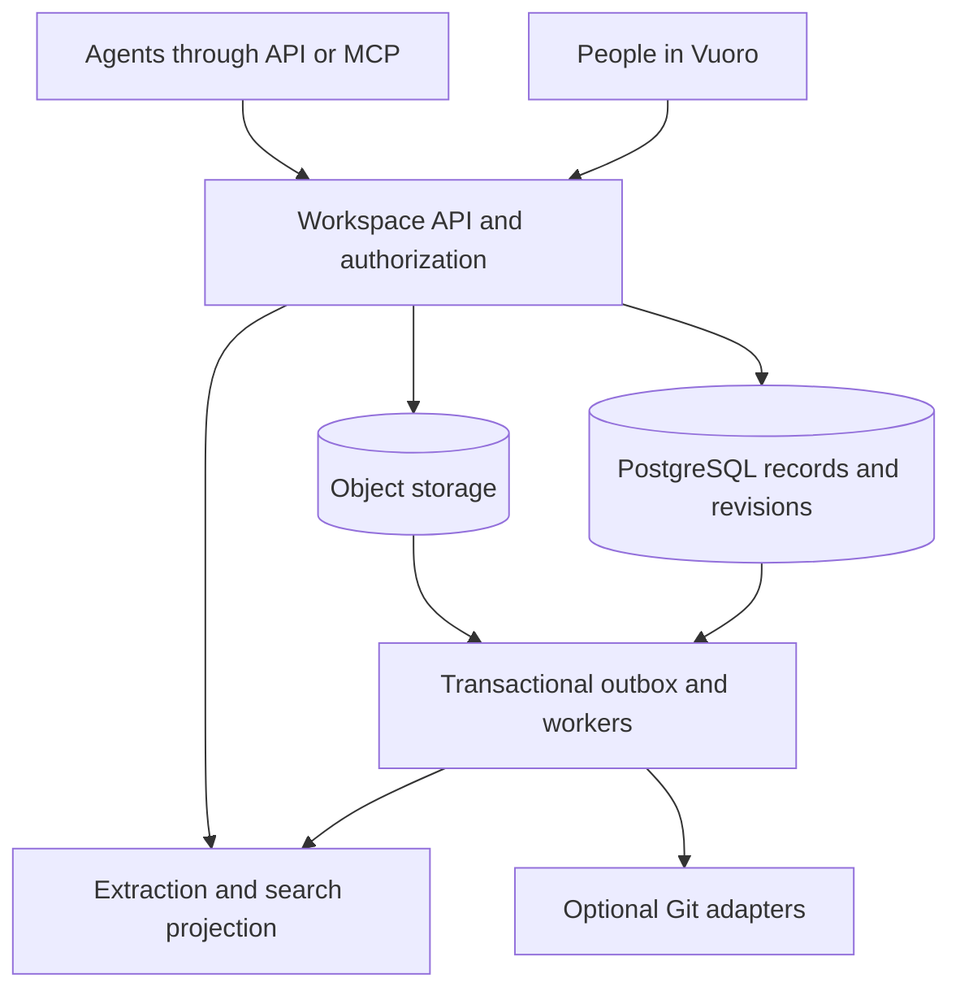

# Vuoro Knowledge and Artifact Workspace Design

> Imported 2026-10-14 from Codex output `vuoro-knowledge-workspace/` (proposal, not ratified).
> It proposes moving document authority from Git into a Vuoro-owned PostgreSQL store for workspace
> knowledge. That conflicts with the boundary in `docs/architecture/knowledge-resolution.md`
> ("does not replace the repositories where that knowledge is authored"); the reconciliation and
> Phase 0 findings are in `docs/plans/2026-10-14-knowledge-workspace-phase0.md`.

Source: [Vuoro Knowledge and Artifact Workspace Design](https://chatgpt.com/space/page_92339d679cc48191954c88afec3e08cf)

## Architecture decision

Draft for engineering review · 14 October 2026

Build an independent knowledge and artifact workspace for Vuoro. Use PostgreSQL as the initial authority for workspace metadata, Markdown revisions, proposals, publication state, and audit records. Use S3-compatible object storage for original artifact bytes and generated derivatives. Begin with PostgreSQL full-text search over a rebuildable extraction index.

Git is optional in the initial design. A future Git adapter can export approved Markdown or ingest selected repository documentation. Forgejo becomes justified if customers need repository-native branching, review, or self-hosted Git access. GitHub is a connector for customer-owned sources.

This design makes an explicit initial choice: document revisions are authoritative in PostgreSQL. Adding a Git projection must not create a second writable authority. Moving a workspace to Git-authoritative storage would require a separate migration decision.

[Product intention](2026-10-14-knowledge-workspace-intention.md) · [Roadmap](2026-10-14-knowledge-workspace-roadmap.md)

## Domain model

Every record carries a tenant ID and workspace ID. Stable IDs are independent of filenames, titles, and storage paths.

| Entity | Purpose |
| --- | --- |
| Workspace | Membership, roles, retention policy, quotas, and scope |
| Knowledge item | Stable document identity and latest approved revision pointer |
| Knowledge revision | Immutable Markdown, parent revision, author, sources, and content hash |
| Artifact | Stable identity for a deliverable and its version history |
| Artifact version | Object key, checksum, media type, size, creator, and processing state |
| Proposal | Candidate revision, expected base revision, rationale, and review outcome |
| Relation | Version-specific edges such as derived from, supports, and supersedes |
| Run reference | Producing agent identity, external run reference, and supplied provenance |
| Audit event | Actor, action, target version, outcome, and timestamp |
| Extraction | Derived text, source version, extractor version, and location anchors |

An artifact's newest version and its latest approved version are separate pointers. Upload success does not imply approval. Relations used as evidence pin exact versions; navigational links may resolve latest approved.

Agent-supplied provenance is labeled as supplied. Authenticated actor identity and server timestamps are recorded by Vuoro. Source links document lineage; they do not independently validate a claim.

## Storage and consistency

An artifact upload follows reserve, transfer, verify, and finalize steps. The API reserves a version and grants a narrowly scoped upload capability. A worker verifies the stored bytes, checksum, actual file type, and quota before marking the version ready. An incomplete upload remains unavailable and expires through a cleanup job.

Finalization commits the artifact metadata and an outbox event in one database transaction. Extraction workers consume events at least once and deduplicate by version and extractor version. A failed extraction never destroys the original; the UI and API expose pending, ready, unsupported, or failed processing status.

Object writes and database commits are not one transaction. Reconciliation detects orphan objects and missing objects. Cleanup uses a grace period and checks for active references before deleting unclaimed objects.

A knowledge proposal includes its expected base revision. Publication atomically verifies the base, records the reviewer, moves the approved pointer, and emits an outbox event. If the base changed, return a conflict with the current revision. Do not silently merge semantic changes.

All retryable mutations accept an idempotency key scoped to tenant, principal, and operation. Reusing the key with different input returns an error. A monotonic workspace event sequence supports change feeds and index watermarks.

Original artifact bytes are versioned without overwriting. Markdown exports and optional Git projections carry the stable Vuoro IDs and revision mapping. Large binaries stay outside Git.

## Agent interface

Expose one domain API, with an MCP adapter using the same authorization and validation paths. Agent access never requires direct database, bucket, or forge access.

| Operation | Contract |
| --- | --- |
| search | Query, workspace, scope, and limit; return ranked accessible sources with versions and status |
| read | Exact item and version or explicit latest-approved selector; return content and provenance |
| begin artifact upload | Reserve a version with expected size and media type |
| finalize artifact upload | Verify bytes and return a stable version ID; safe to retry |
| propose knowledge change | Markdown or patch, expected base revision, evidence, and rationale |
| review proposal | Approve or reject under reviewer authority |
| changes since | Cursor-based sequence of visible changes and tombstones |
| export workspace | Authorized snapshot manifest plus original files and Markdown |

Search results include item ID, version ID, citation locator, publication state, extraction state, and index watermark. Reads resolve exact versions independently of indexing. Agents can distinguish an empty result from stale or incomplete indexing.

A revoked or inaccessible item returns a consistent unavailable response. Change-feed cursors cannot expand access; validate current membership on every call and require resynchronization when necessary.

Example workflow: upload a spreadsheet version; propose a summary citing that version; a reviewer approves it; a later agent reads the approved summary and downloads the cited spreadsheet. A new upload does not change the evidence behind the old summary.

## Permissions and retrieval

The first release has workspace-wide roles: reader, contributor, reviewer, and administrator. Readers see published knowledge and approved artifacts. Contributors can additionally see workspace drafts and upload or propose changes. Reviewers can publish or reject. Administrators manage membership and retention. Personal private drafts are outside this initial model.

Agent credentials have explicit workspace and operation scope. Effective authority is the intersection of the credential scope and the current authority of its sponsoring user or service principal. Autonomous agents cannot publish in the initial release.

Enforce tenant and workspace checks in the service and database policies. Apply current access and publication filters before search results, snippets, counts, or suggestions are returned. Revalidate downloads and exact-version reads. Cached content must not bypass authorization.

Use authenticated download delivery in the initial release so revocation can block new requests immediately. Any later signed download URLs need a bounded expiry and a documented revocation window. Previously downloaded bytes cannot be recalled.

Default search returns latest approved knowledge and approved artifacts. Contributors explicitly choose a working-material scope to include drafts. History is an explicit search mode. Superseded and deleted items do not appear in default results.

Extract Markdown and text-based PDF content first, preserving headings or page anchors. Original spreadsheets and presentations can be stored and downloaded before extraction support exists. Unsupported extraction must be visible. Subsequent extractors should preserve slide IDs or sheet and cell locations.

Start with keyword relevance, title matching, metadata filters, and publication state. Add embeddings only after measuring retrieval failures. Every derived index must remain access-controlled and disposable.

Treat imported documents as source data. Instructions embedded in a retrieved file cannot change tool permissions or the publication policy. Extraction runs in isolated workers with bounded resources and no execution of document macros.

## Lifecycle and operations

Knowledge revisions progress through draft, proposed, and approved states; proposals can be rejected or withdrawn. Publishing a newer revision supersedes the prior approved revision. Artifacts separately track processing state and review state. These dimensions must not be conflated.

When an evidence version is superseded or removed, mark dependent knowledge as needing review. Do not automatically rewrite or unpublish its conclusions. Show an unavailable-source marker when a pinned source can no longer be accessed.

Deletion immediately tombstones the item and excludes it from normal reads and search. Physical purge asynchronously removes eligible originals, derivatives, and index entries after the workspace retention period. Audit records retain minimal event metadata under their own retention policy. Backup expiry and restoration must preserve deletion obligations; restoration cannot silently reactivate tombstones.

Export uses a consistent database snapshot and a manifest of referenced object versions and checksums. Import preserves stable IDs in a new workspace namespace and validates references. An export manifest also records missing or purged versions explicitly.

Back up database state and referenced object versions. Before the external pilot, demonstrate a restore, an index rebuild, an export/import round trip, and replay of queued events without duplicate publications.

Monitor upload failures, extraction backlog, index lag, authorization denials, proposal conflicts, storage growth, and restore outcomes. Proposed pilot objectives: search p95 below two seconds on the agreed test corpus; 95 percent of supported small documents indexed within one minute; RPO at most 24 hours and RTO at most four hours. Phase 0 must define corpus size, file-size limits, concurrency, and cost limits before these become release commitments.

## Alternatives and open decisions

**GitHub as the default backend:** suitable if the product primarily serves existing repository workflows. It introduces repository ownership and installation into onboarding. GitHub Apps provide repository-scoped installation access and webhooks, making them a good future connector foundation. [GitHub App documentation](https://docs.github.com/en/rest/apps/apps)

**Managed Forgejo as the default backend:** useful when native Git access and forge review are central requirements. It adds forge operation and a mapping between forge identities and Vuoro permissions. Its API has compatibility guarantees within major versions, with migration work potentially required across major versions. [Forgejo API documentation](https://forgejo.org/docs/latest/user/api/usage/)

**Bare Git:** appropriate for a narrow internal text-versioning service, but it leaves review, policy, and operational behavior to Vuoro. It is unnecessary for the proposed first release.

**Selected initial design:** database and object storage, with domain-level revisions and review. This fits an artifact-centered workspace and avoids maintaining a forge before there is a demonstrated need.

Future repository ingestion must declare whether it creates an independent imported copy or a live source reference. A read-only Git projection of Vuoro knowledge has Vuoro as its authority. Bidirectional synchronization is deferred. Direct cloning is only allowed when repository access matches the entire permission boundary; sparse checkout controls materialization and is not a document confidentiality boundary. [Git clone documentation](https://git-scm.com/docs/git-clone)

Open decisions for Phase 0: initial pilot workflow and format mix; available Vuoro identity and storage services; hosting region; retention and quotas; reviewer self-approval policy; exact performance envelope; and whether any pilot requires Git-native editing. Product owns workflow and publication policy; engineering owns storage and API decisions; the service owner owns recovery and operational commitments. Named owners remain to be assigned.
